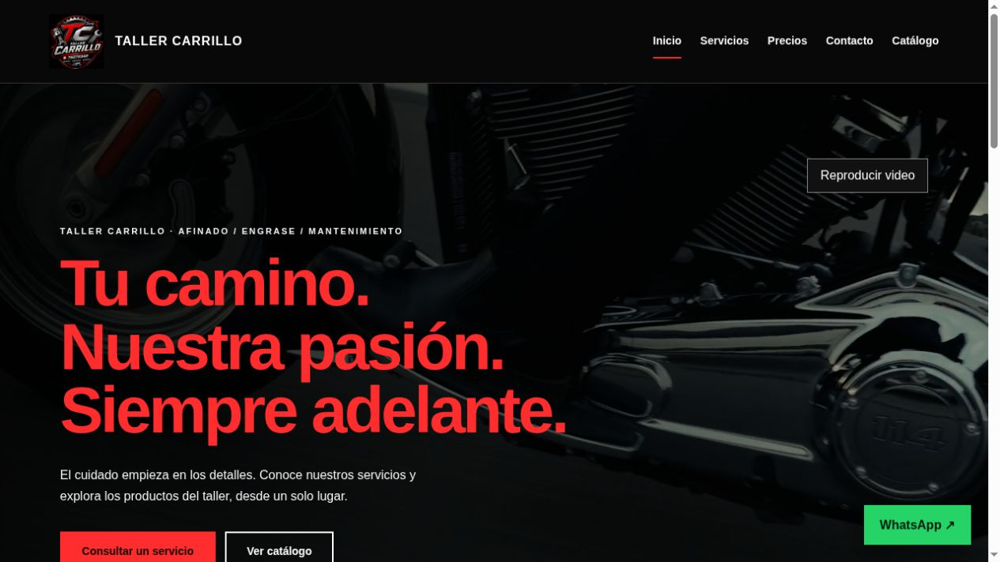
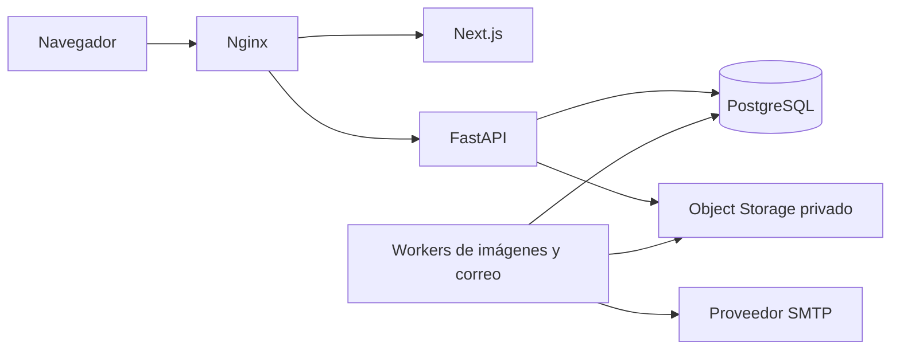

# Taller Carrillo · Inventario y sitio web

Aplicación fullstack para gestionar repuestos de un taller: productos, fotografías,
existencias, movimientos y acceso del personal. La V1 operativa también incorpora
un sitio comercial y un catálogo que los clientes pueden consultar sin registrarse.

[Ver sitio público](https://taller-carrillo.com/sitio) ·
[Documentación](docs/README.md) ·
[Presentación para CV](docs/portfolio.md) ·
[CI en GitHub](https://github.com/Riahrell/taller-carrillo-saas/actions/workflows/ci.yml)

## El problema que resuelve

Centraliza el registro de repuestos y sus existencias para que el taller pueda
consultar qué tiene, registrar por qué cambia el stock y controlar quién puede
modificarlo. El catálogo para clientes permite presentar los productos elegidos
por el administrador sin exponer costos ni información interna.

## Funciones principales

| Área             | Funciones                                                                                                                  |
| ---------------- | -------------------------------------------------------------------------------------------------------------------------- |
| Productos        | Categorías, búsqueda, fotografías, precio y estado activo/inactivo.                                                        |
| Inventario       | Entradas, salidas manuales, conteos, historial, costo promedio y avisos de stock bajo.                                     |
| Personal         | Registro de empleados, vinculación a una empresa y permisos explícitos.                                                    |
| Acceso           | Sesiones mediante cookies, verificación por correo y recuperación de contraseña. Flujos MFA para cuentas que lo requieren. |
| Sitio público V1 | Inicio, servicios, precios, contacto y catálogo sin registro, con enlaces a WhatsApp y Waze.                               |
| Operación        | Contenedores, migraciones, HTTPS y procedimientos de respaldo y restauración.                                              |

**Alcance de la rama:** al revisar GitHub el 3 de noviembre de 2026, `main` estaba
en `5cc7958`. El sitio público, la publicación de fichas y correcciones posteriores
ya existían en la versión operativa registrada, pero sus cambios de aplicación
no estaban incorporados a esa rama. Esta actualización de documentación no los
integra. Consulta [estado y versiones](docs/project-status.md) antes de instalar.

_Captura del sitio V1 publicado; no muestra cuentas ni datos del panel privado._

## Tecnologías y arquitectura

- **Frontend:** Next.js con App Router, React y TypeScript. El sitio V1 añade
  Tailwind CSS y Motion.
- **Backend:** Python, FastAPI, SQLAlchemy y Alembic.
- **Datos:** PostgreSQL, cantidades y valores monetarios exactos, auditoría e
  idempotencia en operaciones de inventario.
- **Infraestructura:** Docker Compose, Nginx, VPS en Contabo y almacenamiento S3
  privado para fotografías. La V1 utiliza Cloudflare delante de los dominios web.
- **Validación:** Pytest, Vitest, Testing Library, Ruff, ESLint y GitHub Actions.

La empresa y los permisos se resuelven en el servidor. El precio de venta se
mantiene separado del costo del inventario. Las actualizaciones que dependen de
una revisión utilizan `ETag` e `If-Match` para evitar sobrescribir cambios ajenos.

## Empezar

| Quiero…                                | Guía                                                     |
| -------------------------------------- | -------------------------------------------------------- |
| Levantar el proyecto en mi computadora | [Desarrollo local](docs/development.md)                  |
| Usar productos, inventario y permisos  | [Guía de uso](docs/user-guide.md)                        |
| Entender el diseño técnico             | [Arquitectura](docs/architecture.md)                     |
| Ejecutar las comprobaciones            | [Pruebas y CI](docs/testing.md)                          |
| Mantener o actualizar la instalación   | [Operación de producción](docs/production-operations.md) |
| Presentarlo en un CV o una entrevista  | [Ficha del proyecto](docs/portfolio.md)                  |

La instalación mínima requiere Docker Engine, Docker Compose y Python 3.13 para
las herramientas del repositorio. Docker proporciona Node.js y PostgreSQL.
Para ejecutar las herramientas frontend fuera de Docker se utiliza Node.js 24.
La guía local explica también cuándo hacen falta SMTP y almacenamiento S3.

## Alcance y límites

Una salida manual de inventario no registra una venta ni un cobro. Las compras
tienen servicios y API de recepción; su pantalla operativa sigue pendiente en el
estado revisado. No se incluye carrito ni pago en línea en el catálogo público.

El repositorio conserva contratos y entregas históricas. El
[índice de documentación](docs/README.md) distingue esos registros de las guías
actuales. Los resultados de pruebas corresponden a versiones concretas; un
resultado antiguo no acredita el estado de una nueva revisión.

## Credenciales

No hay cuentas ni contraseñas predeterminadas. Los scripts generan la configuración
local en `.local/`, excluido de Git. Las claves de base de datos, correo, S3 y
recuperación permanecen fuera del código y de esta documentación.

Proyecto de [Riahrell](https://github.com/Riahrell), aplicado al caso de Taller Carrillo.
