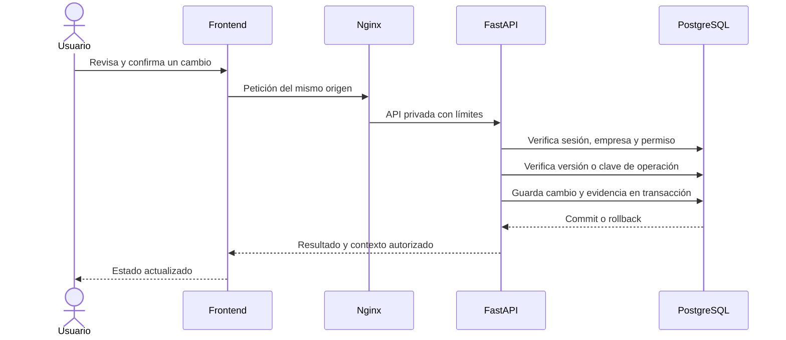

# Arquitectura

Monolito modular con interfaz Next.js y API FastAPI, desplegados como servicios
separados detrás de Nginx. PostgreSQL mantiene los datos operativos. Los workers
procesan imágenes y correo fuera de las peticiones de la interfaz.

## Componentes

| Componente              | Responsabilidad                                                | Código/configuración                   |
| ----------------------- | -------------------------------------------------------------- | -------------------------------------- |
| Next.js                 | Pantallas, formularios y cliente HTTP del mismo origen.        | `frontend/src/`                        |
| FastAPI                 | Autenticación, autorización, validación y transacciones.       | `backend/app/`                         |
| PostgreSQL              | Empresas, accesos, productos, saldos, movimientos y auditoría. | `backend/migrations/`                  |
| Nginx                   | Entrada HTTP/HTTPS, rutas, límites y cabeceras.                | `ops/proxy/`                           |
| Worker de identidad     | Entrega de mensajes solicitados en la aplicación.              | `backend/app/tools/identity_worker.py` |
| Worker de imágenes      | Procesado y mantenimiento de fotografías privadas.             | `backend/app/tools/image_worker.py`    |
| Herramientas operativas | Entornos, CI, certificados, copias y restauración.             | `scripts/`                             |

## Recorrido de una operación

## Empresas y autorización

Una cuenta puede tener membresías en varias empresas. El servidor obtiene empresa,
rol y estado vigente desde la sesión; no acepta que un campo del navegador otorgue
autoridad. Los permisos de consulta y salidas de inventario tienen concesiones
propias. Un administrador actúa sobre su empresa, no sobre cualquier empresa.

Las sesiones utilizan tokens opacos en cookies y registros revocables en la base.
Las escrituras requieren las comprobaciones de origen/CSRF y autorización de la
operación. MFA y recuperación tienen flujos separados. Estas medidas no sustituyen
la revisión de parches ni demuestran ausencia de vulnerabilidades.

## Consistencia del inventario

- Las cantidades y el dinero se calculan con tipos decimales exactos.
- Saldo, valoración y evidencia se actualizan dentro de una transacción.
- Las claves de operación permiten reconocer repeticiones sin duplicar movimientos.
- Las ediciones con revisión exigen `If-Match`; una versión antigua se rechaza.
- El costo promedio proviene de movimientos y recepción, no del precio de venta.
- Una reversa crea evidencia compensatoria; no elimina el movimiento original.

Idempotencia y control de versión resuelven problemas diferentes: reconocer una
operación repetida no autoriza guardar sobre un registro modificado por otra persona.

## Fotografías y tareas externas

Las fotos se validan y reprocesan; las variantes incluyen una miniatura para las
listas. Los objetos se guardan en S3 privado y su lectura requiere autorización
del producto o de su publicación. No se hace público el bucket administrativo.

El worker de correo usa configuración SMTP externa. Los secretos no forman parte
de imágenes Docker ni de ejemplos versionados. Las tareas de mantenimiento y
restauración necesitan sus propias comprobaciones operativas.

## Sitio y catálogo públicos — V1

La versión posterior al `main` revisado separa el dominio público del panel.
Nginx permite únicamente las rutas públicas necesarias en el host del sitio.
La empresa de la vitrina se elige por configuración del servidor, no por un
`tenant_id` enviado por el visitante.

El DTO público solo incluye campos comerciales autorizados. La publicación,
el estado del producto y el estado de la empresa determinan la visibilidad.
El diseño del sitio usa componentes responsive y animaciones con Motion.

Cloudflare se sitúa delante del proxy en la instalación registrada. Las respuestas
API de la corrección V1 usan `no-store, no-transform` para conservar las versiones
HTTP necesarias para editar. No se convierte un ETag débil en autorización válida.

## Redes y despliegue

En desarrollo solo se expone el proxy en loopback. En producción se publican
HTTP/HTTPS del proxy; base de datos, API, frontend y workers permanecen en redes
de Compose. Las migraciones se aplican como paso explícito del despliegue.

La instalación usa releases identificados, secretos externos y copias cifradas.
Los detalles operativos y límites están en [Operación de producción](production-operations.md).
