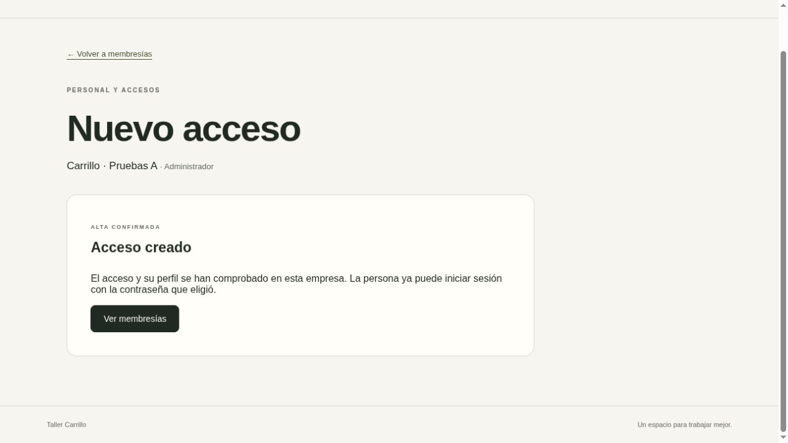

# Entrega: formulario de alta asistida (acceso 2.15)

Fecha: 2026-10-16 (America/El_Salvador).
Rama: `codex/access-user-creation-form`.

## Resultado

El administrador puede abrir `/membresias/nueva` desde el listado, indicar correo
y perfil, revisar esos datos y crear un acceso con el contrato HTTP de 2.14. No
hay perfil seleccionado por defecto. La persona nueva escribe y confirma su
contraseña en un equipo de confianza; no se generan claves predeterminadas.
El servidor conserva la autoridad sobre empresa, permisos y transacción.

La contraseña solo aparece en campos ocultos no controlados durante la
confirmación. Al enviar se vacían los campos antes de la petición; al volver,
cancelar, ocultar o perder contexto se retiran los campos. No se almacena en
estado React, Storage, URL, resumen o logs. Esto reduce exposición; no garantiza
borrado criptográfico de strings JavaScript ni protege frente a un equipo,
administrador o extensión maliciosos.

El cliente exige respuesta 201, contexto del actor, membresía nueva, perfil/estado,
ETag y Location correctos. Después relee sesión y detalle antes de mostrar éxito.
Conserva la sesión del administrador. No reintenta POST automáticamente: conflicto
o validación obligan a revisar de nuevo; los resultados inciertos bloquean el
formulario y solicitan consultar el listado. La UI hereda los controles de
sesión, visibilidad, cambio de empresa y notificación entre pestañas existentes.

## Archivos completos creados o modificados

- `frontend/src/app/membresias/nueva/page.tsx`: página sin datos personales SSR.
- `frontend/src/components/membership-creation.tsx`: edición, revisión, campos
  de contraseña, confirmación comprobada y gestión de errores/contexto.
- `frontend/src/components/membership-workspace.tsx`: modo de alta sobre el
  contexto admin verificado y ciclo de vida existente.
- `frontend/src/components/membership-manager.tsx`: enlace de creación.
- `frontend/src/lib/api/client.ts`: transporte POST con contexto esperado.
- `frontend/src/lib/memberships/api.ts`: comando tipado y validación del 201.
- `frontend/src/app/globals.css`: estilos del formulario y resumen.
- `frontend/tests/user-creation-api.test.ts`: 19 casos nuevos del cliente HTTP.
- `frontend/tests/membership-creation.test.tsx`: 20 casos nuevos del formulario.
- `backend/tests/integration/browser_fixture.py`: aislamiento y limpieza de
  usuarios creados por navegador, credenciales sintéticas en tmpfs privado.
- `docs/security-review.md`: amenazas, evidencia, brechas y orden de cierre.
- `docs/staging-plan.md`: preparación aislada en Contabo, preservando imágenes.
- `docs/deliveries/access-2.15-created.jpg`: evidencia visual sin credenciales.
- `README.md`, `docs/acceptance.md`, `docs/decisions.md`, `docs/permissions.md`,
  `docs/data-model.md`, `docs/user-provisioning-contract.md` y este registro:
  contratos, estado, prioridad de seguridad, resultados y siguiente tarea.

No hay cambios de runtime backend, migraciones, dependencias o secretos nuevos.
Los archivos se entregan completos en el repositorio, sin fragmentos pendientes.

## Comandos exactos de validación y ejecución

Desde la raíz del repositorio, pipeline completo con recursos temporales aislados:

```bash
python3 -m scripts.ci > /tmp/carrillo-access-2.15-verified-ci.log 2>&1
```

Recorrido interactivo con identidades sintéticas y DB temporal protegida:

```bash
python3 -m scripts.browser_qa > /tmp/carrillo-access-2.15-browser.log 2>&1
```

Una vez completado el recorrido de esta ejecución, se señaló al fixture su fin:

```bash
docker exec carrillo-ci-4af33b5426a2-browser-fixture touch /tmp/carrillo-browser-finished
```

El nombre anterior corresponde solo a esta ejecución ya eliminada; el harness
genera un nombre distinto cada vez y publica instrucciones en su salida. No
ejecutar pruebas contra cuentas o bases operativas.

Actualización del entorno local existente, sin regenerar secretos ni datos:

```bash
docker compose --project-name carrillo-dev --env-file .local/development/compose.env -f compose.yaml -f compose.dev.yaml build frontend frontend-tests > /tmp/carrillo-access-2.15-dev-build.log 2>&1
docker compose --project-name carrillo-dev --env-file .local/development/compose.env -f compose.yaml -f compose.dev.yaml up -d --wait --no-deps frontend
docker compose --project-name carrillo-dev --env-file .local/development/compose.env -f compose.yaml -f compose.dev.yaml exec -T proxy nginx -s reload
python3 scripts/smoke_web.py --base-url http://localhost:8080
docker compose --project-name carrillo-dev --env-file .local/development/compose.env -f compose.yaml -f compose.dev.yaml ps
```

Comprobación adicional de la página inicial anónima:

```bash
python3 - <<'PY'
from scripts.smoke_web import read
body, _ = read('http://localhost:8080', '/membresias/nueva')
html = body.decode()
assert 'Nuevo acceso' in html and 'Comprobando acceso' in html
assert 'type="password"' not in html and '@example.com' not in html
print('New access shell OK: no credentials or personal data in initial HTML.')
PY
```

## Resultados reales

- Primer pipeline `carrillo-ci-21d8400b6222`: detenido por ESLint, importación
  `waitFor` sin uso. Se agregó la comprobación de foco del aviso de error.
- Segundo pipeline `carrillo-ci-9007655f0c8f`: detenido por formato Prettier
  de esa aserción; se corrigió el formato. No se cuentan como aprobados.
- Pipeline final `carrillo-ci-fc432d970c31`: exit 0, **CI passed**.
- **592 backend** en 42.35s: 214 unitarias y 378 con PostgreSQL real;
  **6 por proxy real** en 4.61s, contados aparte y una sola vez;
  **129 frontend** en 1.30s y **13 de scripts/configuración**.
  Total **740 pruebas**, 39 nuevas frente a 2.14.
- Ruff/formato en 65 archivos Python, pip check, actionlint, ESLint, Prettier,
  TypeScript y migraciones aprobados. Compilación nueva de Next.js aprobada
  (`Compiled successfully in 990ms`); ruta de alta incluida. Esquema permanece
  en `0007_membership_creation_audit`, sin migración nueva.
- Casos nuevos cubren revisión y perfil explícitos; límites/confirmación de
  contraseña y foco de error; vaciado antes de petición; bloqueo de duplicados;
  cancelación/contexto/visibilidad; descarte de respuesta tardía; conflictos,
  errores y resultado incierto sin retry; cabeceras/cuerpo/201 y ausencia de
  eco de cuerpos privados. Pruebas previas de permisos y transacciones repetidas.
- Navegador real en `carrillo-ci-4af33b5426a2`: admin seleccionó empresa A,
  creó persona sintética con perfil Mecánico y obtuvo “Acceso creado”; listado
  confirmó cuenta/membresía activas. Se comprobó que conservaba la sesión admin;
  tras cerrar sesión, la persona nueva inició sesión como Mecánico en empresa A.
  Acceso directo de ese perfil a `/membresias/nueva` mostró denegación sin formulario.
- Harness de navegador exit 0, fixture **1 passed en 628.65s**, adicional a las
  740 pruebas. Incluye espera humana; no es una medición de rendimiento.
  Ambos proyectos temporales fueron eliminados, con sus identidades de prueba.
- Desarrollo actualizado en `http://localhost:8080`: **cuatro servicios
  saludables**, smoke exit 0 con HTML español, diez assets, API mismo origen,
  404 y rechazos de escritura sin CSRF/origen. Página inicial anónima adicional
  aprobada, sin campos de contraseña ni identidad de prueba en HTML.
- No se crearon cuentas operativas, cambiaron credenciales reales, publicaron
  recursos, accedió al VPS o modificó DNS. No hay push remoto.



## Riesgos pendientes y siguiente tarea

Por indicación expresa del usuario, seguridad tiene prioridad sobre adelantar
inventario. Se sustituye la propuesta de pasar inmediatamente a 3.1 por la
puerta de revisión descrita en `../security-review.md`.

**Siguiente tarea 2.16:** contrato y primer servicio de reautenticación reciente
para acciones administrativas sensibles, con protección en servidor y pruebas
de caducidad, revocación, contexto, CSRF, límites y concurrencia. Actualmente una
sesión válida de hasta ocho horas basta: el formulario no cierra esa brecha.

También siguen pendientes recuperación/cambio seguro de credenciales, revisión
de MFA, auditoría ampliada, revisión de dependencias/secretos, defensas del
navegador y restauración aislada de backups. No hay evaluación ASVS completa,
garantía de ausencia de vulnerabilidades ni declaración de preparación productiva.

El VPS Contabo ya aloja imágenes y el dominio se prevé comprar en Namecheap.
El plan `../staging-plan.md` exige inventario de solo lectura del servidor y
staging aislado con datos de prueba. No se ha elegido dominio ni configurado TLS;
comprar un nombre no habilita HTTPS automáticamente. La elección concreta del
proxy/certificado dependerá del servicio existente. No compartir secretos por chat.
