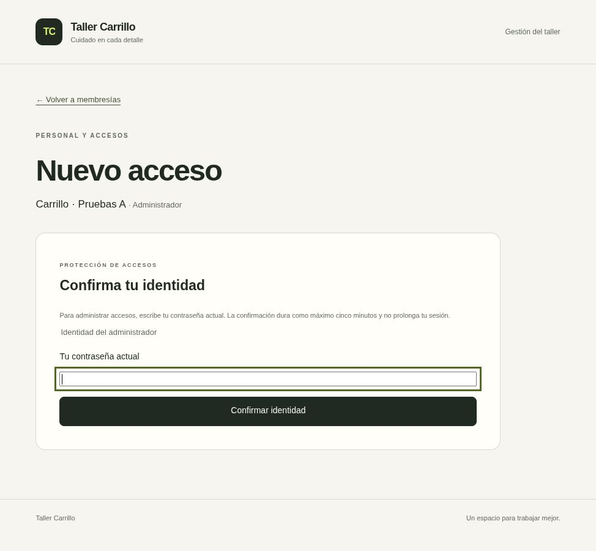
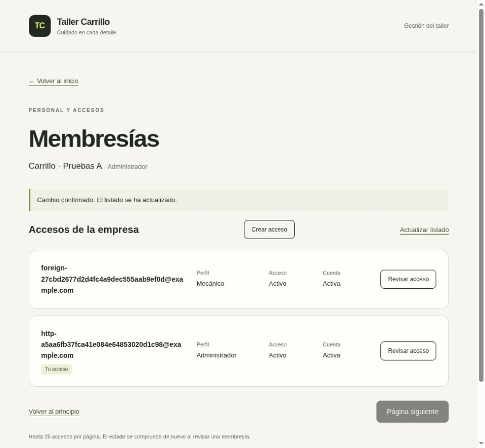
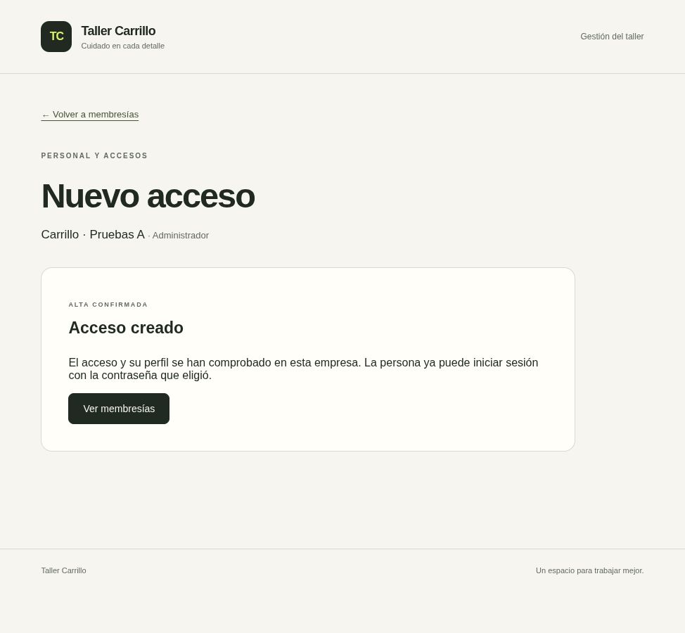

# Entrega: confirmación obligatoria en administración (acceso 2.18)

Fecha: 2026-10-17 (America/El_Salvador).
Rama: `codex/access-required-confirmation`.

## Resultado

Alta y cambio de membresías exigen confirmación reciente dentro de la misma
transacción de autorización/escritura. Un administrador con sesión válida pero
sin prueba vigente recibe 428 `Recent authentication required`, no-store, sin
cookies o metadatos de éxito. El rechazo revierte actividad y cualquier escritura.
Lecturas conservan su permiso admin sin exigir confirmación reciente en la API.

El cambio comprueba vigencia después de adquirir locks y autorizar al objetivo,
antes de ETag/aplicar el cambio, incluso no-op. Conserva último admin, revocación
y auditoría. Un cambio propio puede revocar legítimamente su sesión; no se añade
otra guardia después de esa revocación. El alta comprueba al entrar y de nuevo
después de hashing/inserciones/auditoría, antes de commit: si la confirmación
vence durante el proceso, se revierte la identidad, membresía y evento completos.

El workspace administrativo pide la contraseña actual antes de montar listado,
edición o alta. Es un campo no controlado, distinto de la contraseña del nuevo
usuario. Se vacía antes de esperar red y al desmontar; sin React state, Storage,
URL, logs ni revelado. Tras rotación se relee exactamente usuario/tenant/membresía
y perfil admin. Mutex impide doble envío. El temporizador local conservador usa
hasta 270 segundos desde iniciar el envío, descontando espera/red; el servidor
decide con su reloj y cinco minutos. Navegación/focus/visibilidad/contexto o 428
retiran controles/borradores y exigen nueva revisión, sin replay automático.

Web Locks serializa peticiones de esta versión entre pestañas del mismo origen,
incluyendo lecturas que pueden retirar cookies. Timeout de 15 segundos incluye
la cola. Confirmar requiere navegador compatible en HTTPS o localhost; si falta
Web Locks no se envía la contraseña de confirmación. BroadcastChannel solo avisa
que hay que releer contexto, nunca concede autoridad. Preparación CSRF y envío
siguen separados: una rotación intermedia puede causar un rechazo seguro.

## Archivos completos creados o modificados

- `backend/app/modules/access/administration.py`: guardia dentro de alta/cambio y
  segunda comprobación antes de confirmar el alta.
- `backend/app/main.py`: traducción HTTP saneada de la confirmación requerida.
- `backend/tests/integration/test_recent_administration.py`: **19 casos nuevos**,
  HTTP/PostgreSQL reales, sin marcar confirmación artificialmente: contraseña y
  rotación reales antes de probar vigencia/rollback/espera por locks.
- `backend/tests/integration/conftest.py`: preparación explícita de estado
  confirmado para pruebas de negocio anteriores, exclusivamente en la DB efímera
  protegida por sus guards. No se incluye en runtime ni hay bypass de producción.
- `backend/tests/integration/test_membership_administration.py`,
  `test_membership_routes.py`, `test_user_creation_routes.py` y
  `test_user_provisioning.py`: preparar sesiones confirmadas para conservar las
  verificaciones anteriores de permisos, concurrencia, último admin y rollback.
- `backend/tests/integration/proxy_access.py`: los recorridos de cambio/alta
  comprueban primero 428 y luego reautenticación real antes de guardar.
- `frontend/src/components/identity-confirmation.tsx`: formulario de identidad,
  limpieza, cancelación, contexto, errores y plazo local conservador.
- `frontend/src/components/membership-workspace.tsx`: puerta de confirmación y
  ciclo de vida de controles administrativos.
- `frontend/src/components/membership-manager.tsx` y `membership-creation.tsx`:
  428 retira borradores y exige confirmar/revisar de nuevo.
- `frontend/src/lib/access/api.ts`: confirmación tipada con CSRF, contexto y
  validación estricta del 204; sin reintentos.
- `frontend/src/lib/api/client.ts`: coordinación Web Locks y cancelación de cola.
- `frontend/tests/identity-confirmation.test.tsx`, `reauthentication-api.test.ts`
  y `confirm-identity.ts`: **20 casos nuevos** de secreto, contexto, errores,
  cancelación, contrato y coordinación; helper explícito para pruebas existentes.
- `frontend/tests/membership-workspace.test.tsx`: **3 casos nuevos** de puerta
  previa a datos, respuesta tardía y 428 sin replay; actualizar preparación/reloj.
- `frontend/tests/membership-creation.test.tsx`: preparar confirmación y comprobar
  contexto/428 en el nuevo recorrido.
- `README.md`, `docs/acceptance.md`, `docs/auth-http-contract.md`,
  `docs/membership-http-contract.md`, `docs/permissions.md`,
  `docs/reauthentication-contract.md`, `docs/user-provisioning-contract.md`,
  `docs/security-review.md`, `docs/decisions.md`,
  `docs/reviews/plan-maestro-v1.1.md` y este registro: contratos y estado actual.
- `docs/deliveries/access-2.18-confirmation.jpg`, `access-2.18-confirmed.jpg` y
  `access-2.18-created.jpg`: evidencia visual con identidades sintéticas.

Archivos completos en el repositorio. Sin migraciones, dependencias, secretos o
cuentas operativas nuevas; esquema permanece en `0008_session_reauthentication`.

## Comandos exactos ejecutados

Desde la raíz del repositorio:

```bash
.venv/bin/python -m ruff check backend scripts
.venv/bin/python -m ruff format --check backend scripts
git diff --check
python3 -m scripts.ci > /tmp/carrillo-access-2.18-ci.log 2>&1
python3 -m scripts.ci > /tmp/carrillo-access-2.18-ci-final.log 2>&1
python3 -m scripts.ci > /tmp/carrillo-access-2.18-ci-verified.log 2>&1
python3 -m scripts.browser_qa > /tmp/carrillo-access-2.18-browser.log 2>&1
```

Los dos primeros pipelines fallaron; el tercero es la validación aprobada.
Cada runner genera proyecto, credenciales y PostgreSQL tmpfs propios, y limpia
recursos al terminar. No ejecutar suites contra cuentas/bases operativas.

Verificación local de frontend, desde `frontend/`:

```bash
/home/riahrell/.cache/codex-runtimes/codex-primary-runtime/dependencies/node/bin/node node_modules/typescript/bin/tsc --noEmit
/home/riahrell/.cache/codex-runtimes/codex-primary-runtime/dependencies/node/bin/node node_modules/vitest/vitest.mjs run > /tmp/carrillo-access-2.18-frontend.log 2>&1
```

Tras el recorrido interactivo, fin del fixture de esta ejecución:

```bash
docker exec carrillo-ci-90e33b417092-browser-fixture touch /tmp/carrillo-browser-finished
```

Ese contenedor ya fue eliminado. El harness publica un nombre/puerto distinto
cada vez; sus credenciales sintéticas quedan en archivo privado del contenedor,
no se copian al repositorio ni se usan para el desarrollo operativo.

Actualización del entorno local existente, desde la raíz:

```bash
docker compose --project-name carrillo-dev --env-file .local/development/compose.env -f compose.yaml -f compose.dev.yaml build backend frontend frontend-tests > /tmp/carrillo-access-2.18-dev-build.log 2>&1
docker compose --project-name carrillo-dev --env-file .local/development/compose.env -f compose.yaml -f compose.dev.yaml up -d --wait --no-deps backend frontend
docker compose --project-name carrillo-dev --env-file .local/development/compose.env -f compose.yaml -f compose.dev.yaml exec -T proxy nginx -s reload
python3 scripts/smoke_web.py --base-url http://localhost:8080
docker compose --project-name carrillo-dev --env-file .local/development/compose.env -f compose.yaml -f compose.dev.yaml ps
```

No regenerar secretos ni aplicar una migración nueva para esta actualización.

## Resultados reales

- Primera ejecución local frontend: **128 passed, 1 failed** por espera de Testing
  Library bajo reloj simulado. Se sustituyó esa espera por eventos síncronos en
  esa prueba; las ejecuciones posteriores pasaron, incluida CI con 152 casos.
- Primer pipeline, **carrillo-ci-16afec60d38b**: **6 failed, 723 passed** backend.
  Cinco fallos de preparación por fechas incompatibles con CHECK de vida absoluta;
  otro por segunda sesión admin sin confirmación en el caso de último admin.
- Segundo, **carrillo-ci-dab8042631b9**: **7 failed, 727 passed** backend. Las
  fechas simuladas aún no conservaban exactamente ocho horas. Se corrigió
  `expires_at = created_at + 8h`; no se cambiaron restricciones ni guardias.
- Pipeline final, **carrillo-ci-d595f121488a**, exit 0: **CI passed**.
  **734 backend en 61.14s**: 228 unitarios y 506 PostgreSQL; **7 proxy en 6.30s**;
  **152 frontend en 1.64s** y **13 scripts/configuración**. Total **906 pruebas**,
  **42 nuevas** respecto a 2.17; no sumar repeticiones locales o pipelines fallidos.
- Ruff/formato de 72 archivos Python, pip check, actionlint, ESLint, Prettier,
  tipos, migraciones y builds aprobados. Next.js se compiló de nuevo en el primer
  pipeline (`Compiled successfully in 1096ms`); los posteriores reutilizaron esa
  compilación por caché, sin cambios de código frontend posteriores.
- PostgreSQL: confirmación ausente, vencida, en límite exacto de cinco minutos,
  futura o invalidada por hash cambiado impide alta/PATCH/no-op. Sin efectos
  de negocio, auditoría, revocación o actividad de la escritura rechazada.
  Lecturas siguen autorizadas. Confirmación real permite alta y cambio auditados.
- Caducidad simulada durante hash revierte identidad/membresía/auditoría enteras.
  Otro caso demuestra espera real por lock de empresa consultando `pg_locks`;
  después de liberar, la prueba ya vencida se rechaza sin aplicar el cambio.
- Nginx/Uvicorn reales: alta/cambio obtienen 428 sin confirmación y éxito después
  de confirmar contraseña/rotar cookies. Se repitieron los contratos anteriores,
  incluido login de la persona creada y controles de red/CSRF/límites/logs.
- Frontend: campo vaciado antes de red, doble envío bloqueado, abort/desmontaje
  y respuesta tardía, contexto cambiado, errores sin eco/reintento, puerta previa
  a datos y 428 sin replay. Un GET espera Web Locks y su cola vence sin fetch.
- Navegador real, **carrillo-ci-90e33b417092**: login/empresa A, confirmación de
  identidad, cambio Cajero → Mecánico y mensaje de éxito. Abrir alta solicita otra
  confirmación; rotar desde segunda pestaña retiró el borrador de la primera y
  volvió a pedir contraseña. Confirmar de nuevo mostró datos vacíos/perfil sin
  seleccionar; un alta sintética completa terminó con “Acceso creado”. No se
  afirma que abrir una segunda pestaña en IAB haya simulado ocultación: la
  invalidación observada fue por BroadcastChannel; visibilidad se cubre en tests.
- Harness de navegador exit 0, **1 passed en 399.31s**, adicional a las 906 pruebas;
  incluye espera de interacción, no es una medición de rendimiento. Proyectos
  temporales y cuentas eliminados. Una captura full-page del listado salió
  deformada; se sustituyó por captura del viewport y se inspeccionó correctamente.
- Local actualizado en `http://localhost:8080`: **cuatro servicios saludables**,
  smoke exit 0: HTML español, diez assets, API mismo origen, 404 y rechazo de
  escrituras sin origen/CSRF válidos. Sin uso o cambio de credenciales operativas.





## Riesgos pendientes y siguiente tarea

La confirmación por contraseña no es MFA ni autorización de un solo uso. La
ventana local solo es UX; la autoridad sigue en el servidor. No se promete
borrado criptográfico de strings JavaScript, control del gestor de claves o
protección frente a equipos/extensiones maliciosos. Web Locks coordina clientes
cooperantes; abort/desconexión puede dejar cookies o un commit ya aplicados.
Ante rotación perdida hace falta login; no se reintenta automáticamente.

**2.19: automatizar escaneos de dependencias y secretos**, con herramientas
fijadas, pruebas del pipeline y registro de hallazgos; después contrato de MFA
obligatorio para administradores y recuperación segura, conforme a v1.1. Siguen
pendientes cierre global, credenciales/recuperación, auditoría ampliada, CSP,
ensayo de restauración aislada y preparación de HTTPS/operación. Inventario
espera el cierre de la puerta de seguridad acordada; no hay certificación ASVS
ni declaración de preparación productiva.

No hubo acceso, limpieza, DNS, TLS o despliegue en la VPS; dominio y autorización
de limpieza siguen registrados en `../staging-plan.md`. No hay push remoto,
compras necesarias o configuración de proveedores externos en esta entrega.
