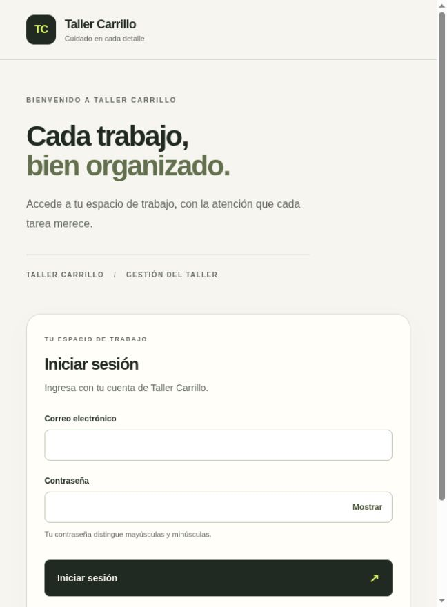
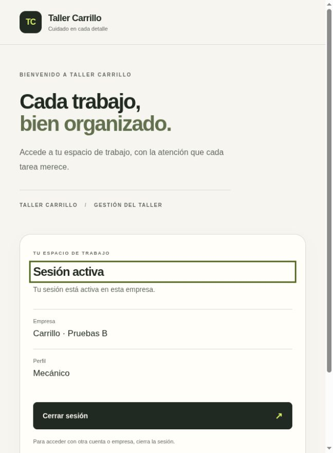

# Entrega: formulario de acceso Next.js (acceso 2.8)

Fecha: 2026-10-16 (America/El_Salvador).
Rama: `codex/access-web-form`.

## Resultado

Formulario en la pantalla inicial: comprobar sesión, ingresar credenciales,
seleccionar empresa explícitamente, mostrar contexto confirmado y cerrar sesión.
Cancelar un selector usa logout para revocar el pendiente. Sin módulos comerciales
simulados, datos ficticios en desarrollo ni cuentas/contraseñas predeterminadas.

El cliente renueva CSRF antes de cada POST y lee solo la prueba del perfil HTTP o
HTTPS. Credenciales same-origin, sin cache, redirects rechazados y respuestas
decodificadas. Origin y cookies privadas los gestiona el navegador. Cada cuerpo
contiene solo email/password, membership_id o {}. Ningún tenant o rol del cliente
concede autoridad.

Contraseña fuera del estado React/Storage y borrada del campo al enviar. Conserva
espacios y Unicode; el login admite 1–128 caracteres, contando puntos de código
y sin imponer el mínimo de alta. HTML method=post para evitar credenciales en URL.
Controles bloqueados y mutex de componente contra doble envío.

Un fallo de red puede ocurrir después de commit: no se reenvían escrituras
automáticamente. La pantalla retira contexto y ofrece comprobar sesión mediante
GET. Un cierre incierto no se anuncia como completado; admite reintento explícito.
Lecturas tardías/abortadas no pueden restaurar el contexto anterior. Foco,
visibilidad, pageshow y señales entre pestañas motivan nueva comprobación, sin
identidad en BroadcastChannel ni polling que renueve sesiones inactivas.

Timers de cliente retiran opciones a los cinco minutos y contexto visible a los
treinta, sin llamadas de fondo ni autoridad sobre la vigencia de DB. Una recarga
del selector pierde opciones efímeras y requiere iniciar acceso de nuevo.

Labels, autocomplete, mostrar/ocultar contraseña, radios sin opción automática,
botones nativos, foco en avisos/títulos, estados busy/disabled y alert/status.
Diseño adaptado al espacio disponible, conservando la identidad visual existente.

Sin cambios de endpoints, esquema, dependencias ni reglas comerciales. Hito 2
abierto: siguen pendientes permisos/administración, último administrador,
auditoría, recuperación y mantenimiento.

## Archivos completos cambiados

- `frontend/src/components/access-panel.tsx`: estados de acceso, formularios,
  recuperación, limpieza de contexto, foco, caducidad visual y señales entre pestañas.
- `frontend/src/lib/access/api.ts`: tipos/decodificadores y transporte de acceso
  con renovación CSRF, selección de cookie y cuerpos acotados al caso de uso.
- `frontend/src/lib/api/client.ts`: GET/POST same-origin, timeout/abort, redirects
  rechazados y errores saneados; ninguna repetición automática de POST.
- `frontend/src/app/page.tsx`, `frontend/src/app/globals.css`: formulario real y
  presentación adaptable; retira la ilustración/aviso de acceso pendiente y CSS sobrante.
- `frontend/tests/access-api.test.ts`: 17 casos de contrato, CSRF, validación,
  timeout y ausencia de retry de escrituras.
- `frontend/tests/access-panel.test.tsx`: 19 casos de estados, foco, duplicados,
  contraseña, selección, fallos, cancelación, Storage, timers y respuestas tardías.
- `frontend/tests/pages.test.tsx`: actualiza expectativa de pantalla inicial.
- `backend/tests/integration/browser_fixture.py`: fixture manual explícito en DB
  efímera, fuera de colección automática y de imagen runtime. Credenciales
  sintéticas aleatorias en archivo privado tmpfs; limpieza al terminar.
- `scripts/ci.py`, `scripts/tests/test_ci.py`: impiden heredar activación de fixture
  de navegador desde variables del host hacia el pipeline.
- `scripts/smoke_web.py`: exige el nuevo HTML de acceso y conserva verificaciones
  de recursos, API, errores y protecciones de escritura.
- `README.md`, `docs/auth-http-contract.md`, `docs/acceptance.md`,
  `docs/decisions.md`, este registro y dos capturas JPEG sin credenciales visibles.

## Comandos exactos ejecutados

Desde `frontend`, con Node 24.19.0 del runtime disponible (el Node del host es 20):

```bash
/home/riahrell/.cache/codex-runtimes/codex-primary-runtime/dependencies/node/bin/node --version
/home/riahrell/.cache/codex-runtimes/codex-primary-runtime/dependencies/node/bin/node node_modules/prettier/bin/prettier.cjs --write src tests
/home/riahrell/.cache/codex-runtimes/codex-primary-runtime/dependencies/node/bin/node node_modules/prettier/bin/prettier.cjs --check .
/home/riahrell/.cache/codex-runtimes/codex-primary-runtime/dependencies/node/bin/node node_modules/eslint/bin/eslint.js .
/home/riahrell/.cache/codex-runtimes/codex-primary-runtime/dependencies/node/bin/node node_modules/typescript/bin/tsc --noEmit
/home/riahrell/.cache/codex-runtimes/codex-primary-runtime/dependencies/node/bin/node node_modules/vitest/vitest.mjs run
```

Desde la raíz, validación completa y actualización de desarrollo:

```bash
.venv/bin/python -m ruff check --config backend/pyproject.toml backend scripts
python3 -m scripts.ci
docker compose --project-name carrillo-dev --env-file .local/development/compose.env -f compose.yaml -f compose.dev.yaml build frontend frontend-tests
docker compose --project-name carrillo-dev --env-file .local/development/compose.env -f compose.yaml -f compose.dev.yaml up -d --wait --no-deps frontend
docker compose --project-name carrillo-dev --env-file .local/development/compose.env -f compose.yaml -f compose.dev.yaml exec -T proxy nginx -s reload
python3 scripts/smoke_web.py --base-url http://localhost:8080
docker compose --project-name carrillo-dev --env-file .local/development/compose.env -f compose.yaml -f compose.dev.yaml ps
git diff --check
```

Una ejecución inicial de `frontend-tests npm run format` sobre la imagen anterior
solo formateó su copia antigua dentro del contenedor; no valida las fuentes nuevas.
Se usó después el Node 24 indicado sobre las fuentes reales y el pipeline final
reconstruyó/probó las imágenes actuales. No se cuenta aquel comando como validación.

## Prueba de navegador y aislamiento

Orquestación temporal ejecutada con `python3 /tmp/carrillo_browser_qa.py`.
Usó Pipeline/guards existentes con proyecto **carrillo-ci-62f160219428**, directorio
temporal dentro de .local y credenciales nuevas de test; DB tmpfs carrillo_test,
roles separados, APP_ENV=test y puerto loopback efímero. Inició DB/migraciones,
proxy y frontend; configuró PUBLIC_ORIGIN al puerto real, conservándolo al
recrear backend y recargar Nginx.

El contenedor de fixture se inició mediante:

```text
run --rm --name carrillo-ci-62f160219428-browser-fixture -e RUN_BROWSER_INTEGRATION=1 tests python -m pytest -p no:cacheprovider -s tests/integration/browser_fixture.py
```

Esos son los argumentos de compose del Pipeline temporal, no del proyecto dev.
No ejecutar el fixture contra datos operativos. Exige activación explícita antes
de preparar identidades y los guards de DB ya existentes; no añade rutas de seed.
Archivo de credenciales 0600 en tmpfs, fuera de stdout de la aplicación. Se usaron
solo esas credenciales sintéticas en el formulario del puerto temporal; no quedan
en la documentación, capturas ni Git. No se introdujeron contraseñas de operador.

Recorrido observado mediante el navegador de la app, en `127.0.0.1:32782`:

1. Formulario preparado por el servidor; campos vacíos y labels correctos.
2. Contraseña errónea: mismo aviso genérico y foco en él; campo de contraseña vacío.
3. Login válido por Enter: selector de dos empresas, ambas sin marcar, Continuar
   deshabilitado y foco en el título.
4. Tab, flecha abajo y Tab: marca únicamente empresa B y enfoca Continuar.
5. Enter: contexto real de empresa B y perfil Mecánico obtenidos del servidor.
6. Recarga: recupera esa sesión y contexto; no pide ni reenvía contraseña.
7. Tab/Enter en Cerrar sesión: vuelve a formulario vacío con Sesión cerrada y sin
   empresa/perfil anteriores.
8. Nuevo login válido y Cancelar acceso: retorna a credenciales y retira opciones.
9. Recarga tras cancelar: acceso anónimo, sin contraseña, opciones ni empresa anterior.

Fin de fixture y limpieza ejecutados:

```bash
docker exec carrillo-ci-62f160219428-browser-fixture touch /tmp/carrillo-browser-finished
```

El test de soporte terminó (1 passed, 591.27s, mayormente espera de la revisión
manual), retiró las identidades y su archivo; el runner eliminó contenedores,
redes, imágenes propias y directorio temporal. Ese caso de soporte no se suma
como prueba funcional automatizada ni como latencia de la aplicación.

Capturas reales a 648×880; contienen solo el formulario vacío o datos sintéticos:





## Resultados reales

- Pipeline final **carrillo-ci-371f4d1d5b82**, **exit 0, CI passed**.
- **307 backend** en 15.81s (152 unitarias + 155 PostgreSQL), más **4 por proxy
  real** en 0.55s. Total backend **311**, sin duplicar los casos adicionales.
- **51 frontend** en 934ms: 19 panel, 17 contrato de acceso, 12 cliente y 3 páginas.
- **13 scripts/configuración**. **375 pruebas en el pipeline**, 36 más que acceso 2.7.
- Ruff/formato correctos en 53 archivos Python; pip check, actionlint, ESLint,
  Prettier y tipos correctos. Build Next.js ejecutado y páginas generadas; caché
  usada donde correspondía. No se presume construcción completamente sin caché.
- Contraseña limpia al submit, Unicode sin truncar, selección explícita, contexto
  actual, timeout sin retry, estados inciertos sin falso éxito, callbacks tardíos,
  ausencia de persistencia en Storage, limpieza de contexto y timers sin polling
  cubiertos por tests frontend.
- Guardar contexto/contraseña en Storage no se invoca en las pruebas. Mensajes
  entre pestañas solo disparan lectura; ningún mensaje concede tenant o rol.
- Primer run local: un test esperaba el aviso de cierre antes de finalizar la
  operación y falló. Se corrigió para esperar el estado final; la suite posterior
  y el pipeline actual aprobaron. Lint de hooks y del mock también se corrigió;
  no se desactivaron reglas. Los intentos previos no se cuentan como aprobados.
- Pipeline previo 93a3b1d64108 también aprobó; el final repitió el conjunto tras
  limpiar CSS anterior. No sumar ejecuciones repetidas como pruebas distintas.
- Navegador real: recorrido listado arriba con Nginx/Uvicorn/PostgreSQL, sin mocks
  de endpoints ni usuario real. Foco y teclado comprobados para aviso, selector,
  confirmación y cierre; capturas inspeccionadas visualmente.
- Desarrollo: frontend actualizado y Nginx recargado, **cuatro servicios saludables**.
  Smoke correcto: HTML español de acceso, diez assets, API mismo origen, 404 y
  protecciones 403/413. No se aplicaron migraciones ni cambios de datos en dev.
- El navegador quedó en **http://localhost:8080/** mostrando el formulario activo.
  Sin publicación, push, usuarios reales nuevos ni regeneración de credenciales DB.

## Uso con una cuenta real

El operador crea el primer administrador desde su terminal siguiendo README.
No se ejecutó ese bootstrap en esta entrega ni se proporcionó una contraseña
predeterminada. La contraseña se introduce y confirma ocultamente en la terminal;
no escribirla en chat, argumentos ni archivos versionados. El formulario ya puede
usar la cuenta que cree el operador en su entorno local.

## Riesgos y pendientes

La prueba manual de navegador no es una suite E2E de navegador automatizada en CI.
Los errores de red, 403/429/503, Storage y cambios entre pestañas se verificaron
en tests controlados; no se simularon todos esos fallos con dos navegadores reales.
No hay auditoría completa de accesibilidad, matriz de navegadores o dispositivos,
TLS real ni benchmark de carga. El viewport observado se declara arriba.

Una recarga/foco que reinicie un selector exige credenciales de nuevo; las opciones
no persisten. Empresas con el mismo nombre pueden resultar ambiguas en la lista;
no se inventaron campos de identificación empresarial para resolverlo. Futuras
pantallas de negocio deberán vaciar sus propias cachés al cambiar sesión/empresa.
El contexto actual está acotado al panel de acceso; todavía no existe ese negocio.

Timeout de cliente no revierte commits y los timers visuales no autentican ni
revocan. La DB y cada operación futura siguen siendo autoridad. Sin idempotencia
entre pestañas ni promesa de borrado seguro de memoria JS o gestores de contraseñas
del navegador. CORS/CSRF/HttpOnly no protegen por sí solos contra XSS.

Permisos por operación, administración, último administrador, auditoría,
recuperación y limpieza mantienen abierto el hito 2. HTTPS, backups/restauración,
hardening, política fiscal y comercio siguen en sus fases. CI remota pendiente:
el repositorio no tiene remoto configurado.

Referencias: [efectos React](https://react.dev/reference/react/useEffect),
[use client Next.js](https://nextjs.org/docs/app/api-reference/directives/use-client).

## Siguiente tarea

Acceso 2.9: autorización en backend y administración segura de membresías, con
revocación coordinada y protección del último administrador, antes de habilitar
operaciones comerciales.
