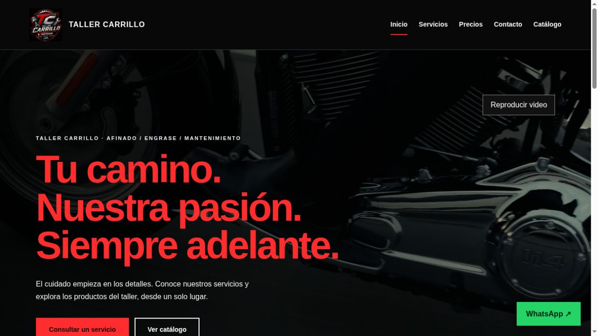
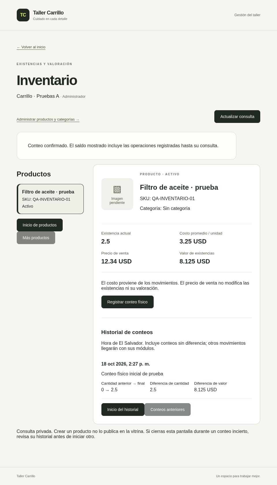

# Taller Carrillo · Ficha para CV y portafolio

**Tipo:** aplicación web fullstack aplicada a un taller de motocicletas.

**Enfoque:** inventario, acceso del personal y presencia comercial.

**Repositorio:** [Riahrell/taller-carrillo-saas](https://github.com/Riahrell/taller-carrillo-saas).

**Sitio público:** [taller-carrillo.com](https://taller-carrillo.com/sitio).

El sitio público permite explorar el resultado sin utilizar una cuenta del panel.

Ver inventario con datos de prueba

Captura histórica de validación con productos ficticios. Ilustra la separación
entre existencias, costo y precio; no representa la interfaz más reciente.

## Texto breve para el CV

**Taller Carrillo — Sistema web de inventario y catálogo**

Desarrollo fullstack con Next.js, TypeScript, FastAPI y PostgreSQL. Gestión de
productos, fotografías, movimientos y permisos por empresa, con pruebas
automatizadas y despliegue en VPS mediante Docker y Nginx.

## Viñetas para ampliar la experiencia

- Implementé catálogo interno, búsqueda, categorías y movimientos de existencias
  con cantidades exactas, historial e idempotencia.
- Desarrollé control de acceso por empresa y permisos, verificación por correo y
  recuperación de contraseña, con validación de origen y CSRF.
- Integré fotografías en almacenamiento S3 privado, procesamiento de imágenes y
  miniaturas para las listas de productos.
- Preparé una V1 con sitio responsive y catálogo público sin registro, manteniendo
  separados los datos comerciales de los costos y existencias internas.
- Configuré despliegue con Docker Compose/Nginx, HTTPS y procedimientos de copia
  y restauración; añadí comprobaciones con Pytest, Vitest y GitHub Actions.

Elige las viñetas que correspondan al trabajo que puedas explicar y demostrar.
El catálogo público y el sitio pertenecen a una versión posterior al `main`
revisado; [Estado y versiones](project-status.md) documenta esa diferencia.

## Presentación de 30 segundos

> Taller Carrillo es una aplicación para administrar repuestos y existencias de
> un taller. El panel permite registrar productos y movimientos, consultar el
> historial y asignar permisos al personal. Utilicé Next.js y TypeScript para la
> interfaz, FastAPI y PostgreSQL para la lógica y los datos, y Docker/Nginx para
> el despliegue. La V1 también incluye un sitio comercial y una vitrina pública
> que muestra solo los productos publicados por el administrador.

## Decisiones técnicas para explicar en una entrevista

| Decisión                                | Problema que aborda                                                |
| --------------------------------------- | ------------------------------------------------------------------ |
| Empresa y permisos resueltos en backend | Evita confiar en un identificador o rol elegido por el navegador.  |
| Transacciones y decimales exactos       | Mantiene coherencia entre saldo, costo y evidencia de movimientos. |
| Claves de operación                     | Permite reconocer repeticiones sin duplicar cambios de stock.      |
| `ETag` e `If-Match`                     | Detecta ediciones basadas en una versión anterior del registro.    |
| Variantes de imagen y bucket privado    | Permite listas con miniaturas y acceso controlado a las fotos.     |
| Base y proxy reales en pruebas          | Comprueba restricciones y recorridos que un mock no reproduce.     |
| Releases y copias verificadas           | Permite preparar actualizaciones y ensayar recuperación.           |

## Demostración sugerida

1. Mostrar el sitio público y su adaptación al tamaño de la pantalla.
2. En un entorno de prueba con datos ficticios, buscar y editar un producto.
3. Registrar una entrada y una salida; explicar cantidad movida frente a conteo final.
4. Mostrar historial y mínimo de stock.
5. Explicar los permisos y el flujo de publicación al catálogo público.

Usa un entorno de prueba para la demostración privada. No compartas la cuenta
operativa, datos de empleados, tokens, correo privado ni configuración de la VPS.

## Presentación honesta del alcance

No se documentan cifras de usuarios, ventas, ahorro o rendimiento porque no hay
mediciones que las sustenten. El proyecto no incluye todavía una interfaz completa
de compras, ventas/cobros ni órdenes. La experiencia verificable está en el código,
las pruebas y el despliegue registrado, no en una certificación de seguridad.

Para el CV, enlaza al repositorio si el destinatario tiene acceso y al sitio
público. Cambiar la visibilidad del repositorio o publicar datos de demostración
requiere una revisión independiente del contenido.
